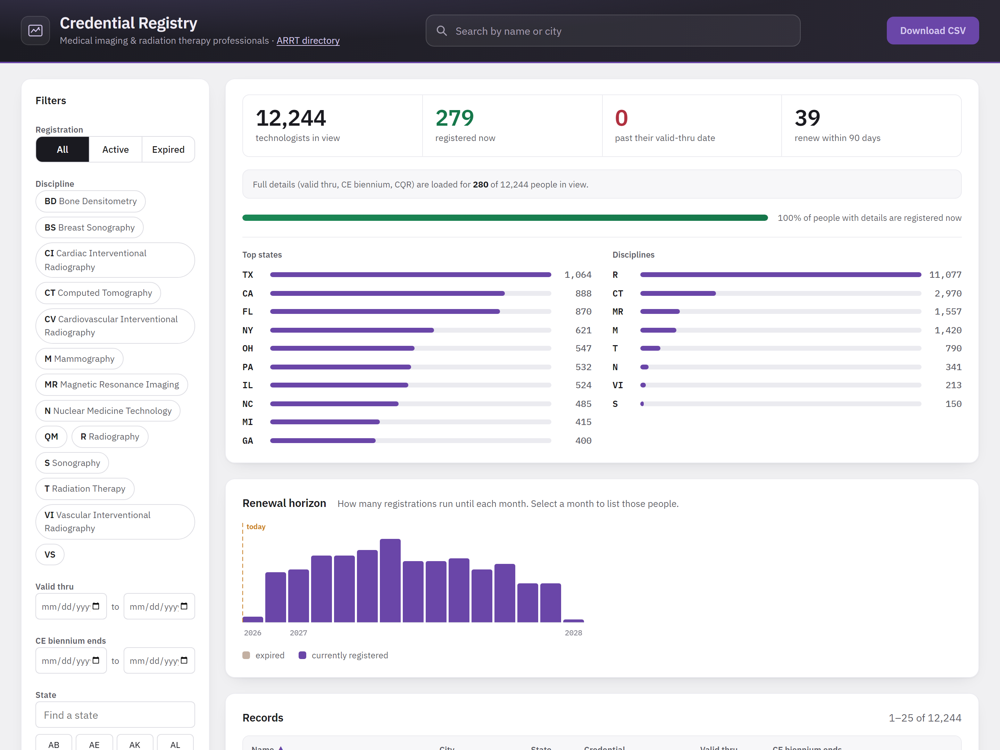
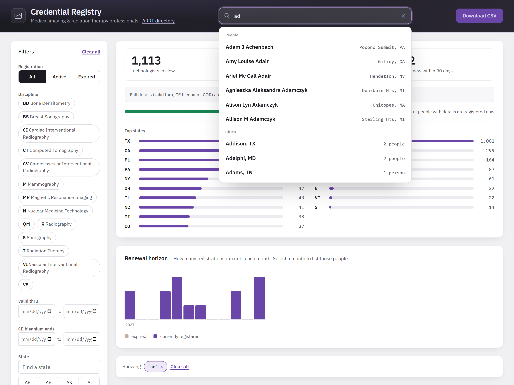
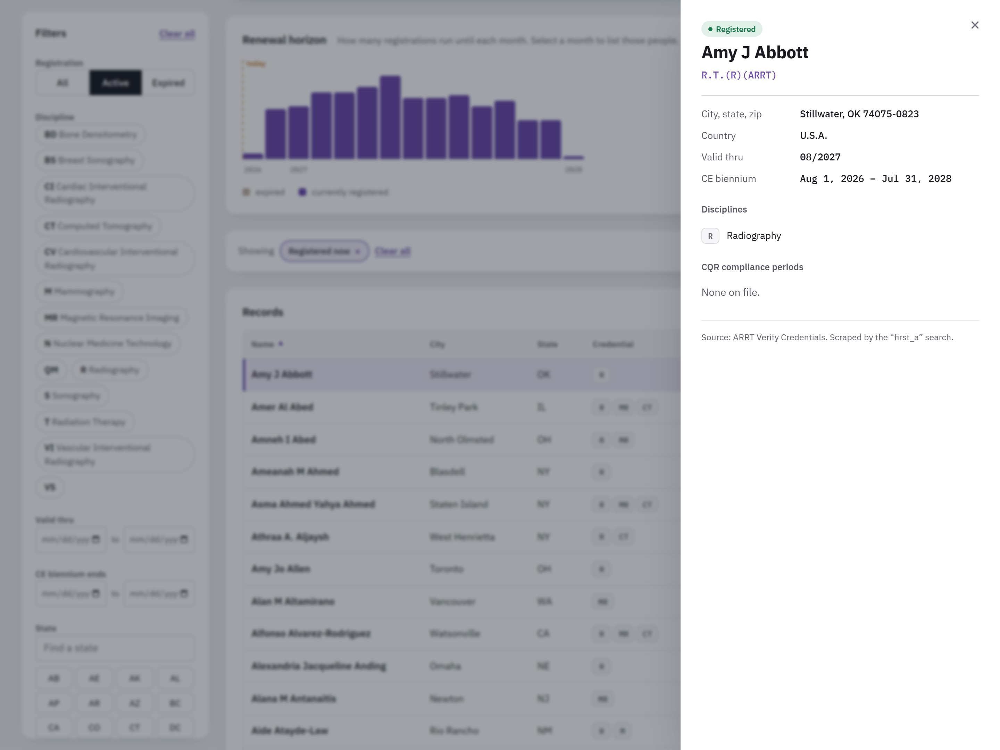

# ARRT Credentials Scraper + Dashboard

Scrapes registered technologists from the [ARRT Verify Credentials](https://www.arrt.org/pages/verify-credentials)
directory into **MySQL** (and CSV), and shows them in a **React** dashboard backed by **FastAPI**,
with filters for name, state, discipline, active/expired status and date ranges.

```
Chrome + human captcha ─► Playwright scraper ─► MySQL (Alembic migrations) ─► FastAPI ─► React dashboard
                                                        └─► CSV export (script + "Download CSV" button)
```

---

## Dashboard

A React + FastAPI dashboard over the scraped data: filter by name, state, discipline,
active/expired status and date ranges; a renewal-horizon chart; and a details panel per person.



Search with autocomplete (people and cities) and the per-person details panel:





## 1. What I found on the site

I read the page's own JavaScript (`/js/custom/VerifyCredentialsWidget.js`) and recorded its network
traffic with a one-off recon script (`scraper/recon.py`). The site makes two plain AJAX calls:

| Call | Sends | Returns | Captcha? |
|---|---|---|---|
| `POST /VerifyCredentials/SearchByName` | `firstName`, `lastName`, `captchaSuccessCode` | HTML table with **all** matching rows | **Yes** (HTTP 424 if missing) |
| `POST /VerifyCredentials/GetDisplayDetails` | `key` (one per row) | HTML of the "View Details" popup | No |

Both send a `RequestVerificationToken` header (ASP.NET anti-forgery token from a hidden input).

Key facts that shaped the design:

- **The `%%` wildcard.** Names are matched with SQL `LIKE 'value%'`. Last name `%%` matches *every* last
  name (the form needs ≥ 2 characters), so last `%%` + first `a` = everyone whose first name starts with A
  — **38,473 people**.
- **One search returns every row.** Paging on the site is done in the browser (DataTables), so a single
  request returns all 38k rows (~20 MB of HTML, ~25 s). No pagination loop is needed.
- **The details key is an encrypted token** (~263 chars, `CfDJ8…`) that changes per search, so it can't
  identify a person. I de-duplicate on `person_key = sha1(name|city|state|credential)` instead.
- **Details are only in the popup**: zip, country, *Valid Thru*, *CE Biennium*, *CQR compliance periods*,
  *Credential Description*. These drive the dashboard's status and date filters, so they matter.
- **ARRT caps "View Details" lookups.** After a few hundred lookups the endpoint still answers
  HTTP 200, but the popup says: *"You have reached the maximum number of lookups. If you wish to do bulk
  lookups contact ARRT at 1-651-687-0048."* The cap is a rolling window (a lookup worked again a few
  minutes later), but it is clearly meant to stop bulk use, so **I stopped there** rather than
  working around it (new sessions, IPs or proxies would be circumventing it). Bulk details should come
  from ARRT directly. The parser treats this message as a failed lookup, never as data.
- **Before the cap, details were slow:** ~2 s per request on the server and requests from one session are
  handled one at a time (ASP.NET session behaviour), so 5 parallel workers gave only ~0.3–0.8 req/s.

## 2. What I tried, what happened, what I changed

The scraper took several attempts. Each problem below was found by testing against the live site.

| # | Tried | What happened | What I changed |
|---|---|---|---|
| 1 | Watch DevTools > Network while searching | Nothing obvious showed up; the page is Blazor | Read the page's JS instead; found both AJAX endpoints and the anti-forgery token |
| 2 | Search with last name `%%`, first name `a` | 38,473 people, because the site uses SQL `LIKE 'x%'` | Defined 7 prefix queries in `config.py`, each sampled to 5,000 |
| 3 | Playwright's bundled Chromium for the captcha | The "I'm not a robot" box did not respond (automation mode) | Launch regular Chrome with a separate profile and attach over CDP; a person still ticks the box |
| 4 | Click Search and read the response | Chrome dropped the 20 MB body from its DevTools cache ("content was evicted") | Send the search POST directly with the human-solved token, like the page's jQuery does |
| 5 | Store the details key as the unique id | Key is ~263 chars and changes every search | Migration `0002`: key as TEXT, de-duplicate on `person_key` (sha1 of name, city, state, credential) |
| 6 | Wait 5 min for a human captcha | Timed out twice while nobody was at the keyboard | 30-min wait; split search from details (`--details-only` needs no captcha) |
| 7 | 5 parallel details workers | Only ~0.3 to 0.8 req/s; ~2 s per request, one session handled one at a time | Kept 5 workers with retries; measured and documented instead of pushing harder |
| 8 | Long details run in a visible Chrome | The window was closed, so every request failed and the progress bar still moved | Hidden browser for details-only runs; stop loudly if the browser closes; save every 25 rows |
| 9 | Keep fetching details | Popup said *"You have reached the maximum number of lookups... contact ARRT"* | Stopped. The parser treats this as a failed lookup, never as data |
| 10 | One lookup a few minutes later | Details came back: the cap is a rolling time window, not a permanent block | Did **not** resume bulk fetching: the site asks bulk users to contact ARRT, so working around the window would defeat the limit's purpose |
| 11 | Need more than 5,000 people without new captchas | The full `first_a` response (38,473 people) was already saved in `data/raw/` | Added `import_raw.py` to grow the dataset from saved responses, with no new requests |

## 3. Approach

### Captcha: solved by a human, never bypassed
The search endpoint is protected by reCAPTCHA. I deliberately do **not** use solver services or tricks —
that would break the site's terms of use. Instead:

1. The scraper opens a normal Chrome window and fills the search form.
2. **You tick "I'm not a robot".** The script waits for `grecaptcha.getResponse()` to return a token.
3. The script sends the search with that token (same URL, fields and headers as the page's own jQuery).

One captcha = one search query. A full run with 7 queries needs **7 clicks**, all at the start; the
remaining work (~thousands of detail pages) needs no captcha and runs unattended.

Because the details endpoint has no captcha, search and details are decoupled: `--details-only` fetches
details for people already in MySQL without any human step. The saved details keys keep working
across browser sessions (verified), so a run can be resumed hours later.

Two practical notes, both found while testing:
- Playwright's bundled Chromium runs in "automation mode", where the reCAPTCHA checkbox doesn't respond.
  So the scraper starts the regular Google Chrome (with a separate throw-away profile in
  `data/chrome-profile/`) and Playwright connects to it over the DevTools protocol.
- The page's own Search click can't be read back for big results: Chrome drops 20 MB response bodies from
  its DevTools cache. So the script sends the search request itself with the human-solved token.

### Variety: several search patterns, defined in one place
Instead of 35k people all named "A…", `scraper/config.py` defines 7 queries:

| Label | First name | Last name | Who |
|---|---|---|---|
| `first_a` … `first_d` | `a` … `d` | `%%` | first name starts with A, B, C, D |
| `last_sm` | `%` | `sm` | Smith, Small, … |
| `last_pa` | `%` | `pa` | Patel, Parker, … |
| `mix_j_jo` | `j` | `jo` | John Johnson, … |

From each query I keep a **random, repeatable sample** (`MAX_RECORDS_PER_QUERY = 5000`, seed 42), so the
data isn't just the alphabetically-first names. Every row records its `source_query`.

### Why Playwright (not Selenium)
| Need | Selenium | Playwright |
|---|---|---|
| Wait for elements | manual `WebDriverWait` | automatic |
| Parallel HTTP calls sharing the browser's cookies | not built in | `context.request.post()` + `asyncio` |
| Attach to an already-running Chrome | awkward | `connect_over_cdp()` |
| Driver setup | match chromedriver version | `playwright install` |

### Speed and safety
- Details run **in parallel** (`DETAIL_WORKERS = 5`) through the browser session, with retries and
  growing back-off (2 s, 4 s, 8 s; 30 s on HTTP 429).
- Rows are saved to MySQL **as soon as each search finishes**, and details are saved in small batches.
  A stopped run loses almost nothing, and re-running **skips people who already have details**.
- Because the details endpoint is throttled, a run fetches details for a random sample
  (`--details-limit`, default 3,000). Run again with a higher limit to fill in more.

### Storage: MySQL with Alembic migrations — two tables
| Table | One row per | Holds |
|---|---|---|
| `credentials` | person | results-table columns **and** every "View Details" field; `raw_details` JSON keeps every label/value exactly as shown, so nothing is lost |
| `scrape_runs` | scraper run | start/end, total time, requests/second, failures, per-query stats (JSON) |

Why only two: disciplines (`"R,CT"`) are filtered with `FIND_IN_SET`, and CQR periods / credential
descriptions are small JSON lists. Separate tables would add JOINs to every query for no gain at this size.

**Active/Expired is not stored** — it depends on today's date, so the API computes it at query time
from `valid_thru_date` (e.g. "11/2026" → valid through 2026-11-30).

Migrations: `0001` creates the tables; `0002` was added after recon showed the details key is a long,
changing token (switches de-duplication to `person_key`).

## 4. Project layout

```
scraper/
  config.py        all settings: queries, sample sizes, workers, Chrome path
  browser.py       open Chrome, wait for the human captcha, send the search
  parsers.py       search HTML -> rows, details HTML -> fields
  clean.py         small pure helpers: names, dates, disciplines, CQR
  details.py       parallel "View Details" fetching with retries
  storage.py       MySQL writes (upserts, resume)
  timer.py         per-stage timing
  run.py           main entry point
  export_csv.py    MySQL -> data/arrt_credentials.csv
  import_raw.py    add more people from a saved search response (no new request)
  close_run.py     record timings for a run that was stopped early
  recon.py         one-off script used to study the site
backend/
  db.py            connection (DATABASE_URL from .env)
  models.py        SQLAlchemy models
  create_db.py     creates the database if missing
  main.py          FastAPI app
migrations/        Alembic (0001 initial, 0002 person_key)
frontend/          React + Vite dashboard
data/              CSV, run_stats.json, raw responses (raw/ and inspect/ are git-ignored)
docs/              ARRT_Project_Report.docx (the single project report)
```

## Tests

```powershell
.venv\Scripts\python -m pytest
```

- `tests/test_clean.py` - the date/name/discipline/CQR helpers (pure functions, no DB).
- `tests/test_parsers.py` - the search and details parsers, run against the **real** HTML
  ARRT returned (saved in `data/inspect/`), so they fail the moment the site's markup changes.
  One test asserts the "maximum number of lookups" page parses as empty, never as a record.

The API's invariants (filter buckets partition the total, pagination/404/validation, CSV honours
filters) were verified with FastAPI's TestClient.

## 5. How to run

**Requirements:** Python 3.12+ (built on 3.15), Node 20+, MySQL 8, Google Chrome.

```powershell
# 1. Python environment
python -m venv .venv
.venv\Scripts\pip install -r requirements.txt
.venv\Scripts\python -m playwright install chromium

# 2. Database: copy .env.example to .env and set your MySQL password, then
.venv\Scripts\python -m backend.create_db
.venv\Scripts\alembic upgrade head

# 3. Scrape (Chrome opens; tick the captcha once per query)
.venv\Scripts\python -m scraper.run                                   # full run
.venv\Scripts\python -m scraper.run --queries first_a --limit 300     # quick test
.venv\Scripts\python -m scraper.run --details-limit 10000             # more details (resumes)
.venv\Scripts\python -m scraper.run --details-only --details-limit 2000  # NO captcha: details for people already saved

# 4. CSV
.venv\Scripts\python -m scraper.export_csv          # -> data/arrt_credentials.csv

# 5. API  (docs at http://127.0.0.1:8000/docs)
.venv\Scripts\uvicorn backend.main:app --port 8000

# 6. Dashboard (http://localhost:5173)
cd frontend
npm install
npm run dev
```

If `CHROME_PATH` in `scraper/config.py` doesn't match your machine, change it there.

## 6. Timings (measured)

<!-- RUN-STATS -->
| Measure | Result |
|---|---|
| Search `first_a` (first name A, last name `%%`) | 38,473 rows returned in 25–27 s (3 runs) |
| Details run #10 | 250 detail pages in 15m 50s = **0.26 requests/s** (stopped when ARRT's lookup cap kicked in; failures not counted because the run was stopped) |
| People in MySQL | **12,244** (first_a: 12,244) |
| People with full details | **280** (279 registered now, 0 expired) |
| Full details for all 35k (projected) | ~35,000 ÷ ~0.5 req/s ≈ **19–20 hours**, before ARRT's lookup cap |

**What is in this submission.** **12,244 people** from the `first_a` search (a random, repeatable
sample of the 38,473 the site returned), of whom **280 have full "View Details" data**.
Details stopped at ARRT's lookup cap (see sections 1 and 2). The other six searches need a person to tick the
captcha, and nobody was at the keyboard during the final runs; they are defined in `config.py` and run
with one command (six clicks, about five minutes):

```powershell
.venv\Scripts\python -m scraper.run --queries first_b,first_c,first_d,last_sm,last_pa,mix_j_jo --skip-details
.venv\Scripts\python -m scraper.run --details-only --details-limit 5000     # no captcha, resumable
```
<!-- /RUN-STATS -->

Every run stores its timings in the `scrape_runs` table and `data/run_stats.json`; the dashboard shows
the latest one under "How this data was collected".

## 7. What the speed depends on

| Factor | Effect we saw | What we did |
|---|---|---|
| Server time per search | 38,473 rows (~20 MB HTML) in 25–27 s | one request per query, no paging loop |
| Server time per detail | ~2 s each; one session's requests run one at a time | 5 workers, retries with back-off |
| ARRT lookup cap | after a few hundred lookups every popup says "maximum number of lookups" | stop; sample; ask ARRT for bulk data |
| Human captcha | each search waits for a person (a run timed out twice while nobody was at the keyboard) | 30-min wait; searches first, details later with `--details-only` |
| Browser stability | a visible Chrome window was closed mid-run, so every request failed | details-only runs use a hidden browser; the run stops loudly if the browser closes |
| Network | home broadband; requests are small (~3 KB), so the server, not the network, was the bottleneck | — |

Projection: details for all 35,000 people at ~0.5 req/s would take **~19–20 hours** even without the cap,
which is why the scraper samples details and records exactly who has them (`has_details`).

## 8. Output: MySQL and CSV hold the same data

`data/arrt_credentials.csv` is exported straight from the `credentials` table
(`python -m scraper.export_csv`), so it always matches the database row for row. Columns:
name (full/first/middle/last), city, state, zip, country, credential string, disciplines, credential
description, **status** (Active / Expired / No details), valid thru (raw + date), CE biennium (raw + start
+ end), CQR periods, **has_details**, source query, details fetched at. The dashboard's
**Download CSV** exports the same columns for just the filtered rows.

## 9. The dashboard

Approach: the API does all filtering, sorting and paging in MySQL, so the browser only receives one page
of rows; every filter is reflected in the summary, chart, table and CSV export at once. Built with React
(Vite), no UI library, plain CSS with a small token palette (slate ink, film-grey, one blue accent; green and
red only ever mean registered / expired). Responsive down to mobile, keyboard accessible, reduced-motion aware.

- **Search with autocomplete** in the header: suggests people (opens their record) and cities (filters by
  city); arrow keys, Enter and Esc work.
- **Active filter chips** above the table say in words what is shown; each chip removes its filter.
- **Coverage note** states how many people in view have full ARRT details.
- **Summary figures** for whatever is filtered: total, registered now, expired, renewing within 90 days.
  "Registered now" and "Expired" are also one-click filters.
- **Renewal horizon** — a bar per month showing how many registrations run until then, with a "today"
  marker. Click a month to list exactly those people.
- **Filters:** name/city search, Active/Expired, discipline (R, CT, MR, …), Valid-thru range,
  CE-biennium-end range, state, and the search that found the person.
- **Records table:** server-side sorting and paging; click a row for a details panel laid out like
  the site's verification popup.
- **Download CSV** exports exactly the filtered rows.

API endpoints: `GET /api/records`, `/api/records.csv`, `/api/records/{id}`, `/api/stats`,
`/api/filters`, `/api/run-stats`.

## 10. Limitations and next steps

| Topic | Now | Next |
|---|---|---|
| Details coverage | sample, stopped at ARRT's lookup cap | request bulk data from ARRT; or re-run `--details-only` later (it resumes) |
| Search coverage | `first_a` only (other searches need a person to tick the captcha) | `--queries first_b,…` = six clicks, ~5 min; or `import_raw` to add more of a saved search |
| Captcha | 1 human click per query, by design | fewer, broader queries = fewer clicks |
| Freshness | one-off run | schedule a daily re-run (the directory updates daily) |
| Tests | parsers verified against saved real responses | add pytest cases using `data/inspect/` HTML as fixtures |
| Scale | MySQL, ~35k rows | add composite indexes / full-text search on names if data grows |
| Frontend | dev server | `npm run build` and serve `frontend/dist` from FastAPI |
